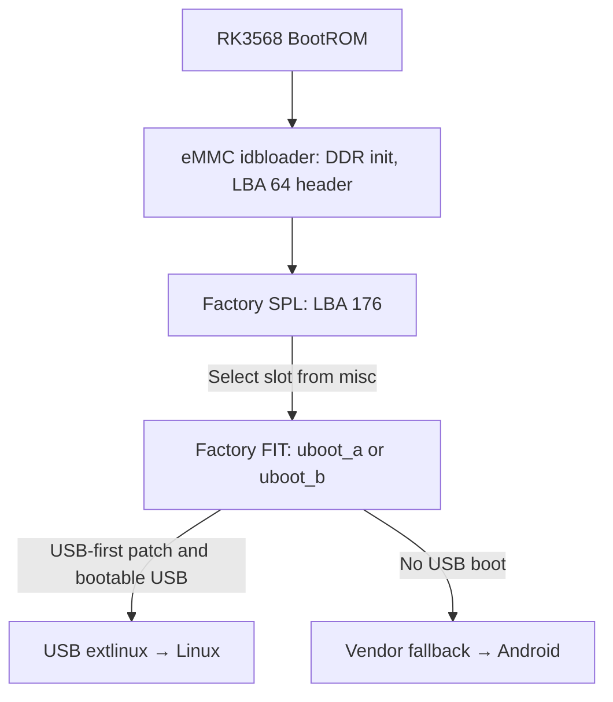

# Factory patch and removable-USB bootflow

## Where the factory SPL lives

The RK3568 BootROM loads `idbloader` from raw eMMC user-area LBA 64
(`0x8000`, 32 KiB). The factory `RKNS` image contains the RAM initialization
code, then U-Boot SPL (Secondary Program Loader) at relative sector `0x70`.
With 512-byte sectors, SPL starts at absolute LBA 176 (`0x16000`, 88 KiB).
It is not in `uboot_a`, `uboot_b`, or the USB image. SPL reads `misc` to pick
the full factory U-Boot FIT in one of the two `uboot_*` partitions; changing
`uboot_a` does not change SPL. See the [image analysis](../bootloader/usb-uboot/_RESEARCH/docs/ab-tries.md#spl)
and [A/B retry behavior](AB-BOOT-RETRIES.md).



## Default USB boot: one U-Boot

```text
eMMC vendor DDR/SPL/ATF/U-Boot
  -> bootcmd_usb0 scans USB extlinux
  -> /extlinux/extlinux.conf on FAT
  -> /boot/Image + /boot/rk3568-zte-w600d-mainline.dtb
  -> root=PARTUUID=24c0d202-02, init=/sbin/init
  -> Ubuntu on USB ext4
```

There are two separate, optional chainload workflows. The
[native-display prototype](NATIVE-UBOOT.md) is manually started from
`/native-uboot/boot-native.scr`; it is not a default, and its handoff to Linux
is not yet validated. The typewriter also uses two U-Boots. Its complete sources,
patches and prebuilts are now in `../bootloader/usb-uboot/`; see
`USB-UBOOT-TYPEWRITER.md`. It is not needed by the new mainline USB. Do not copy
their boot.scr, chainloader or raw U-Boot onto the new disk by habit.

## The already-established factory patch

```text
run bootcmd_usb0;run bootcmd_mmc0;usb stop;boot_fit;boot_android ${devtype} ${devnum};run distro_bootcmd;
```

This flat command scans USB, then eMMC, then continues the vendor Android
sequence when the scans return. Earlier top-level `if ... fi` variants reset
the board; retain the known flat form. The established v15 patch keeps the
stock bootdelay at 0 and clears `bootcmd_pxe` to make room in the fixed default
environment. Older research sections describe earlier variants.

The canonical patcher is
`../bootloader/usb-uboot/01_vendor-env_patch_uboot_a/patch-uboot-env.py`.
`FACTORY-UBOOT-PATCH.md` explains the scoped procedure.
Full historical details, partition layout and recovery notes are also in
`../reference/u-boot-research/docs/`.

## New factory machine: stop before any write

1. Confirm model, board/firmware family, partition layout and active Android slot.
2. Obtain that machine's own stock bootloader copies, A/B metadata and recovery
   backups; record size and SHA-256. Have a verified recovery method.
3. Apply the environment patcher offline to its own stock image; stop if its
   FIT/hash/layout/environment-capacity checks fail. Never bypass those checks.
4. Review the resulting differences and the model-specific flash/recovery
   procedure before authorizing a bootloader write. Keep the rescue copy stock.
5. Do not replace DDR/SPL/ATF, Android partitions or the eMMC layout. Do not flash
   another machine's patched image or install a generic unsigned U-Boot in eMMC.

This snapshot performs none of those factory writes. The current laptop's
USB-first patch is already installed and needs no repeat flash for Linux,
DTS, desktop or USB updates.

## USB layout and boot arguments

Recorded image layout:

| Partition | Start | Filesystem | Purpose |
| --- | --- | --- | --- |
| p1 | 1 MiB | 512 MiB FAT32, bootable, W600D_BOOT | Image, DTB, extlinux |
| p2 | 513 MiB | ext4, W600D_ROOT | Ubuntu and matching modules |

MBR ID `0x24c0d202` gives PARTUUIDs `24c0d202-01` and `24c0d202-02`.
If partitioning a new drive with another ID, update extlinux and `/etc/fstab`
to its actual PARTUUIDs. The FAT mount in the current rootfs is `/media/boot`,
normally read-only.

The included `../build/linux-7.3.6/extlinux.conf` has normal desktop,
text-console rescue and `init=/bin/sh` emergency entries. The emergency shell
is PID1: do not exit it or send Ctrl-D. It is not the normal desktop setup.

## Android fallback: configured, not yet physically accepted

If no USB is present, the bootcmd can fall through to the original Android
sequence. Once it transfers control to a broken Linux kernel, it cannot
automatically return to U-Boot; recovery is to power off and remove USB.

The required final test remains: clean Linux shutdown, USB removal while
powered off, power on, and observe original Android on this laptop. No new
Android/eMMC write was performed in the November 24 display fix or this snapshot.
